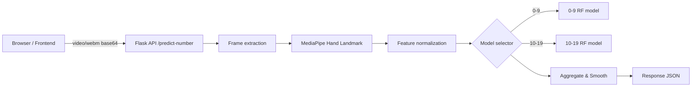
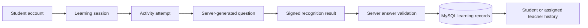

# Sri Lankan Sign Language — Number Gestures Recognition

A web app that recognizes Sri Lankan Sign Language (SLSL) number gestures (0–50) via webcam and turns recognition into interactive arithmetic practice for learners.


---

## Why This Project

- **Bridges accessibility and education** — teaches numbers and arithmetic through natural sign language input.
- **Designed for classrooms and home practice** — kid-friendly UI with Sinhala and English localization.

---

## Highlights

- Real-time number recognition for 0–50 using a webcam
- Interactive arithmetic activities (addition, subtraction, multiplication, division)
- Student-authenticated learning sessions, activity attempts, question attempts, and recognition logs stored in MySQL
- Sinhala and English (i18n) support
- Lightweight inference using scikit-learn RandomForest models

---

## Quick Start

For detailed MySQL installation, account creation, migration, backup, and
troubleshooting instructions, see [MySQL Database Configuration](database/README.md).

### 1. Backend (PowerShell / Windows)

Create a MySQL database first, for example:

```sql
CREATE DATABASE sl_sign_learning CHARACTER SET utf8mb4 COLLATE utf8mb4_unicode_ci;
```

Create the project-root environment file from the example and edit it with your
MySQL settings and a private Flask session key:

```powershell
if (-not (Test-Path .env)) { Copy-Item backend\.env.example .env }
```

Then install and start the backend:

```powershell
cd backend
python -m venv .venv
.\.venv\Scripts\Activate.ps1
python -m pip install -r requirements.txt
flask --app run.py db upgrade
python run.py
```

If the repository or its `.venv` was moved from another folder or drive, recreate
the virtual environment at this location; Windows virtual environments are not
reliable to move. From `backend`, deactivate it if active, remove only the
backend `.venv` folder, and rerun the commands above. Using `python -m pip`
also avoids stale `pip.exe` launchers that still reference the old path.

Generate a session secret with a password manager or a cryptographically secure
secret generator (at least 32 characters). Set `APP_ENV=production`,
`SESSION_COOKIE_SECURE=true`, and configure `RATELIMIT_STORAGE_URI` to a shared
Redis service when deploying. The production backend refuses to start without
HTTPS-only session cookies and shared rate-limit storage.
Do not commit the project-root `.env`; it is ignored by Git. The API listens
on `http://localhost:5000` with debug mode disabled by default. `SECRET_KEY`
and either `DATABASE_URL` or all of `DB_HOST`, `DB_PORT`, `DB_NAME`, and
`DB_USER` are required; the backend intentionally does not silently fall back
to a local database. Do not commit the project-root `.env` file. The example
uses MySQL root with no password for local development only. Use a dedicated
database account in production. See
[backend/.env.example](backend/.env.example) for available settings and
[MySQL Database Configuration](database/README.md) for database setup details.

Student accounts are created from the **Student account** page. Teachers are
provisioned by a trusted operator, then assigned students:

```powershell
flask --app run.py create-teacher teacher-name
flask --app run.py assign-student teacher-name student-name
```

Student and teacher passwords must be at least 12 characters. Teacher
passwords are entered in a hidden prompt. A teacher can retrieve only students
explicitly assigned in the `teacher_students` relationship.

Learning-data tables are installed and updated with Flask-Migrate:

```powershell
flask --app run.py db upgrade
```

When changing models, generate and review a migration before applying it:

```powershell
flask --app run.py db migrate -m "describe the schema change"
flask --app run.py db upgrade
```

The model files listed below must be present in the repository's `models/`
directory before starting the backend.

### 2. Frontend

```bash
cd frontend
npm ci
npm run dev
```

Open the Vite URL (usually `http://localhost:5173`) and allow camera access when prompted.

For a different backend URL, copy `frontend/.env.example` to
`frontend/.env.local` and set `VITE_API_BASE_URL`. Restart Vite after changing
environment variables.

---

## Architecture



---

## API Reference

### `GET /health`

Liveness check.

```json
{ "status": "ok" }
```

---

### `POST /predict-number`

Submit a recorded gesture video and receive a predicted number. Requires an
authenticated student session and a valid CSRF token.

**Request body:**

```json
{
  "video": "data:video/webm;base64,..."
}
```

**Response:**

```json
{
  "predicted_number": 17,
  "model_key": "10-19",
  "confidence": 0.92
}
```

Requests larger than 32 MB are rejected.

---

### Retired legacy arithmetic routes

`POST /activity/generate-question` and `POST /activity/validate-answer` are
retired and return `410 Gone`. Their request format could bypass persisted
learning-attempt tracking, and the old question response exposed its answer.
Use the authenticated learning API instead: start a student activity, create a
server-owned question, record its display and signed recognition result, then
submit the answer to `/api/student-question-attempts/<question_uuid>`. The
legacy responses do not include question answers or create learning records.

### Learning-data API

All application APIs except `GET /health`, `GET /api/auth/me`, and
`POST /api/auth/login` and `/api/auth/register` require an active account.
State-changing requests, including login and registration, must include the
`X-CSRF-Token` returned by `GET /api/auth/me`.
Login and registration rotate the token; the frontend refreshes it with the
same-site session cookie. Session cookies are HTTP-only and expire after 12
hours. Student endpoints reject teacher accounts; teacher history access is
limited to explicitly assigned students. Public registration always creates a
student, while teacher accounts are provisioned by an operator through the CLI.
Login attempts are rate limited.

| Method | Route | Purpose |
|---|---|---|
| POST | `/api/auth/register` | Create and sign in a student (username, password, optional grade) |
| POST | `/api/auth/login` | Sign in |
| POST | `/api/auth/logout` | End active learning sessions and sign out |
| GET | `/api/auth/me` | Return the current account and CSRF token |
| POST | `/api/learning-sessions/start` | Start or resume a UUID-identified learning session |
| POST | `/api/learning-sessions/<uuid>/end` | End a learning session |
| POST | `/api/learning-sessions/<uuid>/abandon` | Mark an interrupted session as abandoned |
| GET | `/api/learning-sessions` | Paginated session history |
| GET | `/api/learning-sessions/<uuid>` | Read one owned session and its summary |
| POST | `/api/student-activities/start` | Start an operation attempt with `difficulty_level` (`adaptive`, `easy`, `standard`, or `hard`; the API defaults to `standard`, while the activity UI defaults to `adaptive`) |
| POST | `/api/student-activities/<id>/questions` | Resume or generate a server-owned question |
| POST | `/api/student-activities/<id>/number-questions` | Resume or generate a prompted number-identification target |
| POST | `/api/learning-questions/<uuid>/displayed` | Record the question display time |
| POST | `/api/student-question-attempts/<question_uuid>` | Submit an answer or skip; server computes correctness |
| POST | `/api/student-activities/<id>/complete` | Complete an activity attempt |
| GET | `/api/student-activities/history` | Paginated activity history |
| POST | `/api/student-recognition-logs` | Record a signed recognition result; number prompts are scored server-side |
| GET | `/api/student-recognition-logs` | Paginated recognition history |
| GET | `/api/student-question-attempts` | Paginated attempts, optionally filtered by `operation_type` or `session_id` |
| GET | `/api/student-question-attempts/<id>` | Read one owned attempt and its recognition logs |
| GET | `/api/personalized-learning/dashboard` | Read weekly progress, activity completion, strengths and achievements, operation performance, recommendations, learning path, and difficulty history |
| GET | `/api/personalized-learning/recommendations` | Read active personalized recommendations |
| GET | `/api/personalized-learning/learning-path` | Read the personalized learning path and its progress |
| GET | `/api/personalized-learning/difficulty-history` | Read recent operation-specific difficulty changes |
| GET | `/api/personalized-learning/students` | List students assigned to the authenticated teacher |

Personalized-learning read routes are available to a student for their own
records, or to a teacher for an explicitly assigned student using the
`student_id` query parameter. New math activities use the student's
operation-specific level when `difficulty_level` is `adaptive`. Difficulty is
promoted or reduced only after the configured minimum sample, recent accuracy,
historical accuracy, and consecutive-answer rules agree at the difficulty
actually attempted. Accuracy windows, history, and streaks exclude answers at
other difficulty levels; only attempts at the student's current adaptive level
can trigger an adjustment. Completing a level's sample cannot be accelerated
by performance on an easier or harder level. Every change records its
level-specific evidence and reason. Locked learning-path steps are reprioritized
as operation performance changes, while completed and current steps are
retained. A current path step remains in
progress until mastery is demonstrated: at least the configured minimum number
of scored answers, the promotion recent-accuracy threshold, the promotion
historical-accuracy threshold, and the configured consecutive-correct streak
must all be met. Defaults require 8 scored attempts, 85% recent accuracy, 75%
historical accuracy, and 5 consecutive correct answers. Finishing an activity
alone does not complete its path step; students can repeat the activity while
the step remains current. Paths now contain separate arithmetic stages for easy,
standard, and hard difficulty, plus number-identification stages for 0-9, 10-19,
20-29, 30-39, and 40-50. Each stage requires mastery evidence from its own
difficulty or number range; success on one stage does not complete another.
Path-linked arithmetic activities open at the stage's difficulty.
Number-identification mastery excludes low-confidence recognitions and other
unscored events. Path-linked number-identification activities draw targets from the
current range; general practice draws from 0 to 50. A confidently recognized sign
is compared with that target and recorded as correct or incorrect; low-confidence
recognitions and legacy gestures without a target remain unscored. Recognition
confidence is tracked separately from answer correctness. Existing recognition
records created before targets were introduced are not retroactively scored
because their expected number was never stored.

Weak-area detection reports its evidence per operation and can use low overall
or recent accuracy, a sustained decline between accuracy windows, a consecutive
incorrect-answer streak, frequent skips, or repeated hint use. Behavioral rates
are evaluated over a recent window with enough observed activity; recognition
confidence is not treated as incorrect math performance.

Recommendations reference entries in the in-code learning activity catalogue
rather than only an operation name. The catalogue currently contains the
existing generated arithmetic activities (addition, subtraction,
multiplication, and division) and prompted signed-number practice. Each
recommendation includes its catalogue ID, activity format, learning objective,
and in-app launch route; it does not advertise lesson formats the application
does not provide.

The personalized dashboard also includes a seven-day UTC progress series,
activity completion totals and rates overall and by operation, evidence-based
strengths, and achievement milestones. Weekly accuracy counts only attempts
with a correctness result. Activity completion rate is completed activities
divided by all started activity attempts; in-progress and abandoned attempts
remain visible in the denominator and status totals. A strength requires the
minimum scored sample plus the configured promotion historical and recent
accuracy thresholds. Milestones are derived from activity, weekly practice,
strength, and mastery evidence and are not stored as permanent awards.

The rule-based policy is configurable in the root `.env` using
`PERSONALIZATION_MIN_ATTEMPTS`, `PERSONALIZATION_RECENT_WINDOW`,
`PERSONALIZATION_PROMOTION_ACCURACY`,
`PERSONALIZATION_PROMOTION_HISTORY_ACCURACY`,
`PERSONALIZATION_PROMOTION_STREAK`, `PERSONALIZATION_DEMOTION_ACCURACY`,
`PERSONALIZATION_DEMOTION_HISTORY_ACCURACY`, and
`PERSONALIZATION_DEMOTION_STREAK`, `PERSONALIZATION_WEAK_TREND_DECLINE`,
`PERSONALIZATION_WEAK_HINT_RATE`, and `PERSONALIZATION_WEAK_SKIP_RATE`.
The weak-signal defaults flag a 15-point recent accuracy decline, hint use on
at least 50% of recent scored answers, or skips on at least 25% of recent
answer/skip events. These explainable rules are the current
personalization engine; the app does not train a model from fabricated or
insufficient student data.

Every mathematical submission is stored as its own question attempt. An
incorrect answer leaves the question open for another attempt; only a correct
answer or an explicit skip completes that question. Idempotency keys protect
each submission from network retries without suppressing a later, deliberate
attempt. Activity and session summaries distinguish questions presented,
valid answer attempts, completed and skipped questions, accuracy, and response
time. `total_attempts` counts submitted answers with a correctness result;
skips, unanswered submissions, and invalid answers are excluded. The question
history endpoint's top-level `total` counts all stored records for pagination,
while its `summary.total_attempts` follows the same definition as activity and
session summaries. Logging out abandons in-progress sessions and activities
rather than marking unfinished work as completed.

The learning schema uses `users` as the student identity (no duplicate student
record), plus `student_learning_sessions`, `student_activity_attempts`,
`learning_questions`, `number_identification_questions`,
`student_question_attempts`, `student_sign_recognition_logs`, and
`teacher_students`. Question answers are kept server-side; submitted correctness
is always calculated on the server. Recognition status (`recognized`,
`low_confidence`, `no_gesture`, or `processing_failed`) is stored separately
from correctness. For number-identification prompts, only `recognized` results
with confidence of at least `0.60` are scored against the stored target.
Low-confidence results are logged for recognition analytics but do not affect
answer accuracy.
Accepted recognition records include the signed model key when the inference
service provides one; this is kept with recognition events, not answer scoring.
Prediction responses carry short-lived, signed proofs bound to the student's
session; the tracking endpoint rejects fabricated, mismatched, expired, or
replayed prediction results. Webcam recordings are processed for prediction and
are not persisted as learning data. Generated multiplication questions are
bounded so their answers remain within the recognizer's supported 0–50 range.

The frontend requires an authenticated student account before number or math
activities and reads the performance report from the backend. Historical
reports saved by older versions only in browser local storage are not imported:
they are client-editable and cannot be treated as trusted learning records.
Math activities default to adaptive difficulty and students may instead choose
`easy`, `standard`, or `hard`. The selected level is persisted with the activity
and changes operation-specific operand ranges while keeping generated answers
within 0–50.

The learning-data flow is:



Run backend tracking tests with:

```powershell
cd backend
python -m unittest discover -s tests
```

---

## Models

Five RandomForest models cover contiguous numeric ranges:

| File | Range |
|---|---|
| `0-9_numbers_rf_model.joblib` | 0 – 9 |
| `10-19_numbers_rf_model.joblib` | 10 – 19 |
| `20-29_numbers_rf_model.joblib` | 20 – 29 |
| `30-39_numbers_rf_model.joblib` | 30 – 39 |
| `40-50_numbers_rf_model.joblib` | 40 – 50 |

Each model receives flattened feature vectors derived from MediaPipe hand landmarks per frame. Per-frame predictions are aggregated via temporal smoothing / majority vote to yield the final prediction and confidence score.

---

## Tech Stack

| Layer | Technologies |
|---|---|
| Frontend | React 18.3.1, Vite 5.4.10, Tailwind CSS 3.4.14, React Router DOM 7.14.2, Node.js 18+ |
| Backend | Flask 3.0.3, Flask-CORS 4.0.0, Flask-Limiter, Flask-SQLAlchemy, Flask-Migrate, Redis, PyMySQL, Python 3.9+ |
| Database | MySQL 8+ or MariaDB 10.11+ |
| Vision | OpenCV contrib 4.11.0.86, MediaPipe 0.10.14 |
| Models | scikit-learn 1.6.1, NumPy 1.26.4, Pandas 2.2.2, Joblib 1.4.2 |

---

## Project Structure

```
Sri-Lankan-Sign-Language-Number-Gestures-Recognition-Final-Year-Research/
├─ backend/
│  ├─ run.py                        # Server entrypoint
│  ├─ app.py                        # App & blueprint registration
│  ├─ requirements.txt
│  ├─ routes/
│  │  ├─ prediction_routes.py       # /predict-number endpoint
│  │  └─ activity_routes.py         # /activity endpoints
│  └─ utils/
│     ├─ inference_engine.py        # Frame extraction, landmarks, model orchestration
│     └─ activity_engine.py         # Question generation and validation logic
├─ frontend/
│  ├─ index.html
│  ├─ package.json
│  ├─ vite.config.js
│  └─ src/
│     ├─ App.jsx
│     ├─ components/
│     │  ├─ WebcamRecorder.jsx      # Camera capture & recording
│     │  └─ LanguageSelector.jsx
│     ├─ pages/
│     │  ├─ NumberIdentificationPage.jsx
│     │  ├─ ActivitiesPage.jsx
│     │  └─ ActivityReportPage.jsx
│     ├─ services/
│     │  └─ api.js                  # API wrapper and base URL
│     └─ i18n/
│        ├─ en.json
│        └─ si.json
├─ models/                          # Trained .joblib artifacts
├─ docs/
│  └─ DETAILED_README.md
├─ README.md
└─ LICENSE
```

---

## Prerequisites

- Python 3.11+
- Node.js 18+ and npm (or yarn)
- A webcam and a modern browser (Chrome, Edge, or Firefox) with camera access on `localhost`
- Optional: `ffmpeg` for inspecting or re-encoding sample videos

---

## Configuration

The frontend API URL is configured with `VITE_API_BASE_URL` (see
`frontend/.env.example`); when empty, it targets port `5000` on the same host
used by the frontend to keep session cookies same-site. Set an explicit API URL
for deployment; if the frontend and API are on different sites, configure
`SESSION_COOKIE_SAMESITE=None` and HTTPS-only cookies.

The backend accepts these environment variables:

| Variable | Default | Purpose |
|---|---|---|
| `HOST` | `127.0.0.1` | Address for the development server |
| `PORT` | `5000` | API port |
| `FLASK_DEBUG` | disabled | Set to `1` to enable Flask debug mode locally |
| `APP_ENV` | `development` | Use `production` to enable production configuration checks |
| `SESSION_COOKIE_SECURE` | disabled | Require HTTPS-only session cookies; required in production |
| `SESSION_COOKIE_SAMESITE` | `Lax` | Cookie SameSite policy; use `None` only with HTTPS |
| `CORS_ORIGINS` | `http://localhost:5173,http://127.0.0.1:5173` | Comma-separated allowed browser origins |
| `RATELIMIT_STORAGE_URI` | `memory://` | Rate-limit storage; configure shared Redis in production |
| `MODEL_DIR` | `<repository>/models` | Model directory; relative paths resolve from the repository root |

Set `CORS_ORIGINS` to the exact frontend origin(s) when deploying the API.
Do not use wildcard origins, enable Flask debug mode, or expose the development
server directly to the public internet. Keep Redis credentials and the session
secret private; use a dedicated MySQL account with least privilege.

---

## Troubleshooting

**Camera doesn't start** — check the browser permission prompt and ensure no other application is using the camera.

**MediaPipe not detecting a hand** — ensure good lighting, reduce background clutter, and hold the hand steady for at least one second.

**Inconsistent predictions** — record a slightly longer clip, improve lighting, or check backend logs for warnings from `inference_engine`.

**CORS errors** — confirm the backend is running and Flask-CORS is enabled; check the browser console for the failing endpoint URL.

---

## License

MIT License — see [LICENSE](LICENSE) for details.

**Author:** Sachinda Bandara — contact via repository issues.